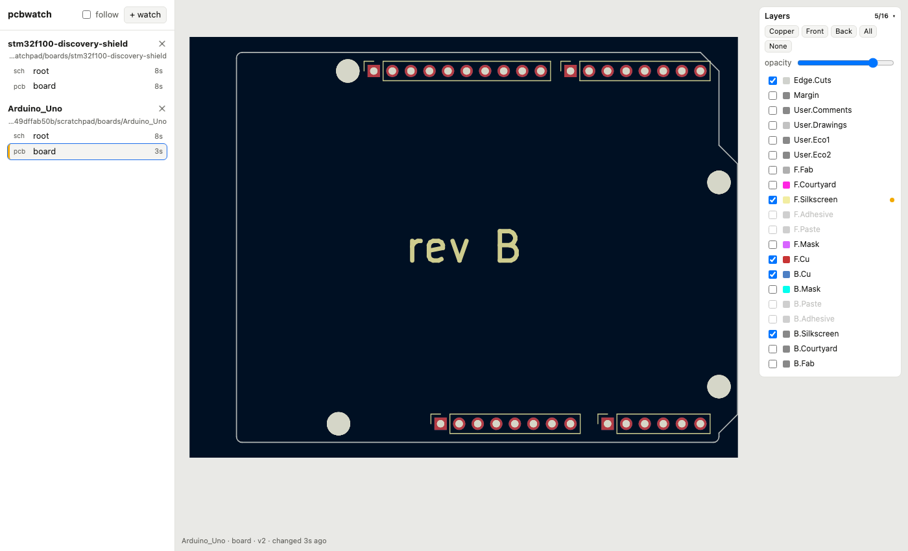
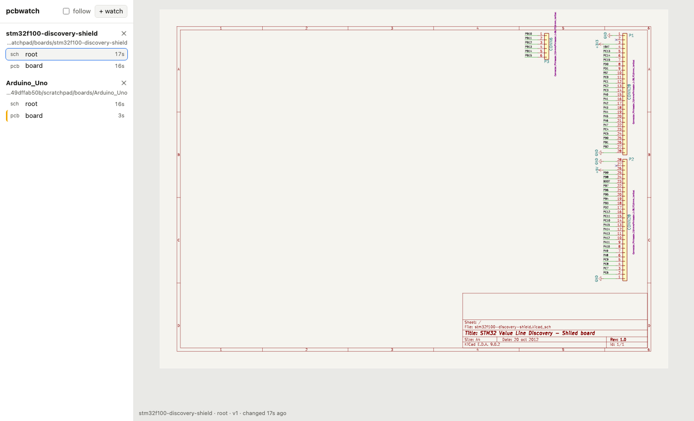

# pcb-viewer

`pcbwatch`: **a live view of KiCad projects while someone else edits them.**

When AI agents (or colleagues) are working on schematics and boards, you
want to see what they are doing without opening KiCad and reloading by hand.
`pcbwatch` is a small local web app you keep open on the side: pick the
projects to watch, and every time a `.kicad_sch` or `.kicad_pcb` is saved
the picture updates in place.





## Quick start

You need **KiCad 9 or newer** (for `kicad-cli`) and
[**uv**](https://docs.astral.sh/uv/getting-started/installation/). uv fetches
a suitable Python itself, and there are no other dependencies.

Run it straight from GitHub, without cloning:

```bash
uvx --from git+https://github.com/daponsr/pcb-viewer pcbwatch
```

Or from a clone:

```bash
git clone https://github.com/daponsr/pcb-viewer && cd pcb-viewer
uv run pcbwatch
```

Or install it as a command:

```bash
uv tool install git+https://github.com/daponsr/pcb-viewer
pcbwatch
```

<details><summary>Without uv</summary>

`pcbwatch.py` is a single, standard-library-only file (Python 3.9+), so
`python3 pcbwatch.py` works too. Copy that one file anywhere and run
`uv run pcbwatch.py`: its inline script metadata tells uv which Python to use.

</details>

Your browser opens at <http://127.0.0.1:8765>. Click **+ watch** and choose
a project, or paste a path to any project folder, `.kicad_pro`, `.kicad_sch`
or `.kicad_pcb`.

## What you get

**Picking projects**
- **+ watch** lists every KiCad project under `~/Documents/GitHub`, newest
  first, with a filter box. **↻** searches again after an agent creates a
  new project. Use `--root` to search somewhere else.
- The watch list is remembered in `~/.pcbwatch.json`.

**Seeing changes**
- The sidebar shows each project's schematic sheets (in hierarchy order)
  and its board, with how long ago each changed.
- Anything that changed in the last 30 seconds gets a yellow edge.
- **follow** jumps to whatever changed most recently, which is handy with
  several agents at once.
- Updates swap in without resetting your zoom.

**Board layers**
- Every layer the board defines is listed in KiCad's colours, front at the
  top. Tick any combination; they are stacked like KiCad stacks them.
- Presets: **Copper**, **Front**, **Back**, **All**, **None**. An
  **opacity** slider lets lower layers show through.
- A yellow dot marks the layers that just changed, so you can tell
  "it rerouted B.Cu" from "it moved some silkscreen".
- Layers with nothing on them are greyed out. Your layer choices are
  remembered.

**Navigating**
- Scroll to zoom, drag to pan, double-click to fit.
- The URL carries the selected view (`#w=…&k=…`), so a view can be
  bookmarked.

**When an agent breaks a file**
- If a file is half-written or invalid, the last good picture stays up and
  the error shows in red.
- It clears on the next good save.

## Options

| Flag | Default | |
|---|---|---|
| `--root DIR` | `~/Documents/GitHub` if it exists, else the current directory | where **+ watch** looks for projects |
| `--port N` | `8765` | |
| `--no-open` | | don't open a browser tab |
| `--version` | | print the version |

| Environment | |
|---|---|
| `KICAD_CLI` | path to `kicad-cli`, if it isn't on `PATH` or in KiCad's default install location (macOS `/Applications/KiCad`, Windows `C:\Program Files\KiCad\<version>\bin`, Linux `/usr/bin`) |
| `PCBWATCH_CONFIG` | where to keep the watch list (default `~/.pcbwatch.json`) |

## What it is not

- **Read-only.** It never writes to your projects.
- **Local only.** It binds to `127.0.0.1` and refuses cross-origin
  requests. Don't expose it to a network: it renders any KiCad file path it
  is given.
- **Not a reviewer.** It doesn't diff, run DRC/ERC, or keep history. It
  shows the latest state, quickly.

## Troubleshooting

| Symptom | Cause |
|---|---|
| `kicad-cli not found` | Set `KICAD_CLI=/path/to/kicad-cli`. On macOS it lives in `KiCad.app/Contents/MacOS/`. A Flatpak KiCad has no `kicad-cli` on disk; use a distribution package or the PPA. |
| `pcbwatch needs KiCad 9 or newer` | It relies on KiCad 9's per-layer SVG export. Upgrade KiCad. |
| Project not in the **+ watch** list | It's outside `--root`, or under a hidden, `node_modules` or `*-backups` folder. Paste its path instead. |
| Every layer marked as changed after a small edit | Something was placed outside the board outline. The view frames everything on the board, so that reframes every layer. Expected. |
| Old KiCad 5 projects (`.sch`, no `.kicad_sch`) show no schematic | `kicad-cli` 9 renders only the KiCad 6+ formats. |

## More

- [How it works](docs/how-it-works.md): architecture, the HTTP API, and the
  `kicad-cli` behaviour it relies on.
- [Contributing](CONTRIBUTING.md): running the tests, and the design rules.
- [Security policy](SECURITY.md)
- [Design spec](docs/superpowers/specs/2026-10-24-pcbwatch-design.md) and
  [implementation plan](docs/superpowers/plans/2026-10-24-pcbwatch.md).

## License

[MIT](LICENSE)
